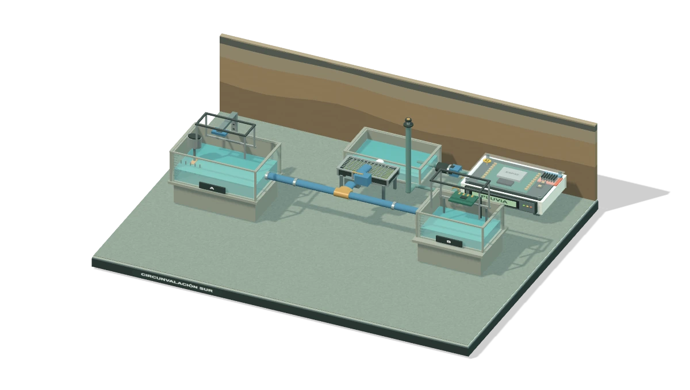

# Pluvia

Pluvia es un prototipo de monitoreo y alerta temprana de acumulación de agua en desagües pluviales. La versión de dos desagües representa una cuadra ilustrativa de Circunvalación Sur, Machala. El desagüe A (D1) aloja una sonda y un motor con paletas. B (D2) incorpora el segundo sensor. A mitad del tubo que los comunica, una compuerta desvía agua hacia el filtro. El agua llega al nuevo estanque y una sola bomba la impulsa al dispersor del parterre.



## Entrega académica de Nivelación TI

Universidad Técnica de Machala · Paralelo C · Grupo 5.

### Equipo

| Integrante | Función confirmada |
| --- | --- |
| Anthony Jara | Líder del grupo · GitHub: [Anthonyyy-y](https://github.com/Anthonyyy-y) |
| Ricardo Sizalima | Por confirmar |
| Patrick Llanos | Por confirmar |
| Jesus Pauta | Por confirmar |
| Erick Changkuon | Por confirmar |
| Emily Quiñones | Por confirmar |
| Kleiner Toro | Por confirmar |
| Jalil Cuenca | Por confirmar |

### Código y recursos por área

- [PSeInt](PSeInt/MonitoreoPluvia.psc) y [Java](Java/MonitoreoPluvia.java).
- [Electrónica y firmware de dos desagües](firmware/PluviaDos/).
- [Simulación electrónica en Wokwi](https://wokwi.com/projects/481630393585899521) y [archivos del circuito](public/descargas/Wokwi_Pluvia.zip).
- [Sitio público](https://pluvia-mu.vercel.app/), [monitor](https://pluvia-mu.vercel.app/monitoreo/) y [repositorio del equipo](https://github.com/Anthonyyy-y/pluvia).
- [Informe final en Word](docs/entrega/Informe_Pluvia.docx) y [matriz de verificación](docs/entrega/Matriz.md).

Cada integrante debe registrar su aporte desde su propia cuenta.

## Abrir en esta computadora

Desde la carpeta `WEB`, ejecuta el servidor con Python 3.9 o posterior. Para la exposición local basta la biblioteca estándar. Three.js, la tipografía, los planos y las imágenes se sirven desde el proyecto.

```sh
python3 -B server/app.py
```

Abre la [portada local](http://127.0.0.1:8080/). Mantén la terminal abierta durante la exposición y usa Ctrl+C para detenerla. Si el puerto está ocupado, ejecuta `PORT=8081 python3 -B server/app.py` y cambia el puerto en el navegador.

La primera ejecución crea las bases SQLite en `data/`. La demostración del monitor funciona sin credenciales. Para consultar lecturas enviadas al servidor, configura `MONITOR_PASSWORD` y `DEVICE_TOKEN` en el entorno privado y reinicia el servicio. El operador usa la contraseña en la pestaña **Nube**. La placa utiliza el token y el `DEVICE_ID` correspondiente al receptor. [Configuración de despliegue](docs/DESPLIEGUE.md)

## Páginas de la exposición

| Página local | Qué encontrarás |
| --- | --- |
| [Inicio](http://127.0.0.1:8080/) | Marca, descripción y modelo interactivo de la cuadra. |
| [Sobre el proyecto](http://127.0.0.1:8080/proyecto/) | Origen, problema y propósito del monitoreo. |
| [Nuestro producto](http://127.0.0.1:8080/producto/) | Explorador 3D de dos desagües, fichas y catálogo de montaje. |
| [¿Cómo funciona?](http://127.0.0.1:8080/funcionamiento/) | Del tubo A–B al riego, con el recorrido de agua y las señales de control. |
| [Simulación](http://127.0.0.1:8080/simulacion/) | Circuito de Wokwi, componentes y archivos para reproducirlo. |
| [Monitoreo](http://127.0.0.1:8080/monitoreo/) | Demostración, USB, Wi-Fi local y nube con historial según la fuente. |
| [Proceso de desarrollo](http://127.0.0.1:8080/proceso/) | Etapas, evidencias disponibles y fotografías pendientes. |
| [Desarrollo tecnológico](http://127.0.0.1:8080/tecnologia/) | PSeInt, Java, electrónica, descargas y repositorio. |
| [Resultados y aplicaciones](http://127.0.0.1:8080/resultados/) | Pruebas de software, diagnóstico físico, limitaciones y mejoras. |
| [Nuestro equipo](http://127.0.0.1:8080/equipo/) | Los ocho integrantes y los datos aportados para sus fichas. |
| [Contacto](http://127.0.0.1:8080/contacto/) | Canales del proyecto, QR y formulario de demostración. |

En **Nuestro producto**, alterna **Superior (tuberías)**, **Frontal** y **Superior cubierta**. Selecciona una pieza con el ratón, un punto interactivo o el menú de componentes. La ficha muestra ubicación, función y especificación. El recorrido guiado, la vista explotada y el flujo de agua permiten revisar la topología de la instalación. Con el lienzo enfocado se puede girar mediante las flechas, acercar y alejar con + y − y restablecer la cámara con Inicio. La alternativa sin WebGL conserva los planos y el catálogo. La escala vertical del modelo es ilustrativa. [Guía de cuatro vistas](public/assets/guia-urbana.pdf)

## Del ESP32 al navegador

El sketch vigente es [PluviaDos.ino](firmware/PluviaDos/PluviaDos.ino), para ESP32 WROOM clásico. Usa JSN-SR04T en A y HC-SR04 en B, una LCD paralela, tres LED y una LDR. Tras cada arranque, vacía el estanque y confirma el punto de partida manteniendo BOOT un segundo o enviando V por USB. Luego estima los segundos de riego disponibles con el tiempo de desvío y el de bombeo. Por eso `nivelEstanque` se publica como `null`; `reservaEstimadaS` informa el cálculo disponible. Las distancias nominales de montaje y los tiempos se ajustan en [Ajustes.h](firmware/PluviaDos/Ajustes.h).

| Fuente del panel | Recorrido de los datos |
| --- | --- |
| Demostración | Genera escenarios ilustrativos en el navegador. Permite probar niveles altos en D1 o D2, un fallo de sensor, riego o interrupción de lecturas. |
| USB | Web Serial lee dos líneas JSON por ciclo a 115200 baudios. El usuario selecciona el puerto y cierra el monitor serie de Arduino antes de conectar. |
| Wi-Fi local | El navegador consulta `GET /api/v1/lecturas` en la IP de la placa. La dirección se anuncia por USB. |
| Nube | La placa envía un paquete v2 por HTTPS a `POST /api/v1/telemetry`. La API valida el token, el dispositivo y las dos lecturas, y deduplica por arranque y secuencia. El panel autenticado consulta el último estado y el histórico. |

`ts` es el tiempo de adquisición del sensor desde el arranque. La nube asigna su propia fecha de recepción. Una lectura `null` indica falta de medición válida. El estado de bomba, motor o compuerta informa la orden del controlador. El panel permite exportar el historial a CSV. La caducidad y la desconexión describen la antigüedad del enlace. [Configuración de USB, red y carga de la placa](firmware/PluviaDos/LEEME.txt) · [Contrato y API](server/GUIA.md)

Para Vercel, el almacenamiento persistente es PostgreSQL. Para `server/app.py` o un servidor WSGI, es SQLite. En ambos casos el formulario de contacto genera una referencia al guardar la solicitud. El servidor local conserva además la API SSE y el simulador CLI del contrato anterior para instalaciones compatibles. [Operación y copias](docs/DESPLIEGUE.md#datos-contactos-y-copias)

## Editar el producto

| Recurso | Archivo |
| --- | --- |
| Textos, integrantes, enlaces, catálogo, fichas y referencias a evidencias | [Contenido editable](public/content.js) |
| Nombre mostrado, navegación y presentación de las once páginas | [Identidad](public/config.js), [navegación](public/site-nav.js), [páginas](public/editorial.js) y [estilos](public/pages.css) |
| Geometría agrupada, iluminación, cámara, selección y gestos | [Modelo](public/model/assembly.js) y [visor](public/model/viewer.js) |
| Explorador, catálogos y láminas de identificación | [Interacciones](public/app.js), [catálogo](public/catalog.js) e [ilustraciones](public/material-art.js) |
| Planos | [Superior cubierta](public/assets/urbano-planta.svg), [tuberías](public/assets/superior-tuberias.svg), [frontal](public/assets/frontal.svg) y [recorrido](public/assets/urbano-corte.svg) |
| Interfaz y validación de las fuentes del monitor | [Monitor](public/monitoreo/index.html), [cliente](public/panel.js) y [lecturas](public/monitor-datos.js) |
| Acceso, persistencia y despliegue | [Plantilla de entorno](.env.example), [servidor local](server/app.py), [función Vercel](api/endpoint.py) y [guía de publicación](docs/DESPLIEGUE.md) |

Los renders WebP proceden de la misma geometría que el explorador. Las fotografías reales del montaje y la validez de las mediciones físicas se documentan en las páginas de proceso y resultados. Las dependencias visuales incluidas tienen sus propias licencias. [Three.js](public/vendor/three/LICENSE) · [Inter](public/vendor/inter/LICENSE)

## Verificación y alcance

Desde la carpeta `WEB`, ejecuta la suite del servidor. Utiliza bases temporales y comprueba recepción, autenticación, mensajes inválidos, reintentos, historial y separación de fuentes.

```sh
python3 -B -m unittest discover -s tests -v
```

Para las pruebas de navegador instala las dependencias de desarrollo y Chromium. La prueba abre un puerto temporal y utiliza credenciales de ensayo.

```sh
npm install
npx playwright install chromium
npm run probar:web
```

Para el montaje físico quedan por comprobar la alimentación estable, las lecturas de ambos sensores con una regla, el caudal del filtro y la bomba y una recepción real del perfil v2. El diagnóstico previo del 23 de noviembre registró reinicios por baja tensión. Después de retirar la placa del protoboard se observó un LED estable. El monitor de producción seguía esperando la primera lectura. El montaje de dos desagües del 24 de noviembre fija 10 cm de altura útil de referencia y requiere calibración en cada recipiente.

La carpeta `firmware/MonitoreoAgua`, su [prueba de regresión](firmware/probar.py), el [simulador HTTP por CLI](server/simulator.py) y el [ejemplo de paquete v1](server/telemetria.ejemplo.json) conservan el perfil anterior de tres estaciones. El receptor admite ese histórico y el panel lo identifica como perfil anterior. Para cargar la versión actual utiliza [PluviaDos](firmware/PluviaDos/LEEME.txt).

## Consultar solicitudes de demostración

El formulario de Contacto conserva los mensajes en la base de datos. La [bandeja privada del equipo](https://pluvia-mu.vercel.app/solicitudes/) se abre con la contraseña del monitor. Muestra fecha, nombre, correo del visitante, mensaje y referencia, y permite marcar cada solicitud como leída. Desde Contacto también se encuentra el enlace a esa bandeja. Las fotografías de construcción y montaje están incorporadas en Proceso de desarrollo.
