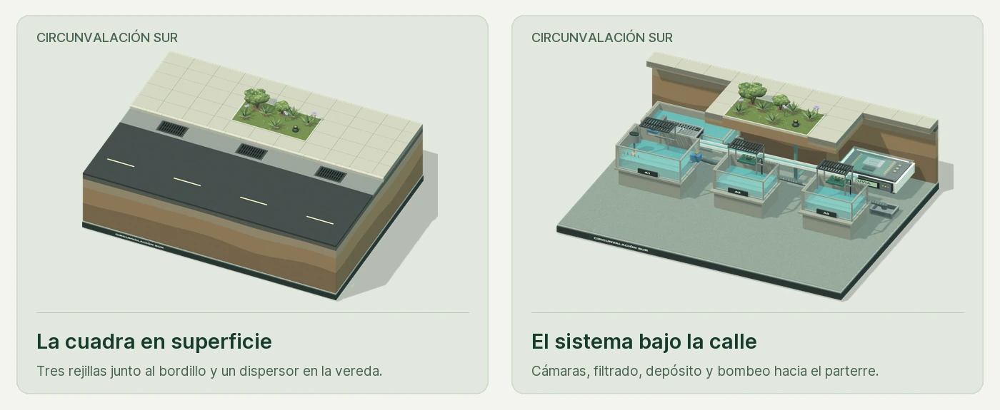

# Pluvia

Plataforma para presentar y supervisar un prototipo de drenaje pluvial en una cuadra ilustrativa de Circunvalación Sur. En superficie hay tres rejillas a ras de la cuneta y un parterre ornamental en la vereda, con un único dispersor. Las cámaras, el filtro, el depósito, las bombas y el compartimento seco de electrónica se encuentran bajo rasante. Incluye la web pública, una maqueta 3D editable, el catálogo de montaje, el monitor privado y una demostración pública con su propio historial.



## Abrir en esta computadora

Desde la carpeta `WEB`, ejecuta el servidor con Python 3.9 o posterior. Para la exposición local basta la biblioteca estándar de Python. El visor, su tipografía y los gráficos están incluidos en la entrega.

```sh
# Ejecuta desde la raíz del repositorio
python3 -B server/app.py
```

Abre la [presentación y maqueta 3D](http://127.0.0.1:8080/) o el [panel de demostración](http://127.0.0.1:8080/monitoreo). Mantén la terminal abierta mientras utilizas la plataforma. Pulsa Ctrl+C para detenerla. Si el puerto 8080 está ocupado, usa `PORT=8081 python3 -B server/app.py` y abre ese puerto en el navegador. Si mueves la carpeta a otro equipo, cambia el directorio del primer comando.

La primera ejecución crea las bases SQLite en `data/`. La demostración arranca sin credenciales. Para habilitar el [monitor real](http://127.0.0.1:8080/monitoreo?modo=real), configura una contraseña privada en `MONITOR_PASSWORD` y reinicia el servidor. Después del inicio de sesión, mostrará **Esperando datos del dispositivo** hasta recibir el primer mensaje autenticado. El token privado del ESP32 se configura por separado en `DEVICE_TOKEN`.

## Recorrido para la exposición

1. Gira la cuadra desde la portada. Busca las tres rejillas junto al bordillo. El dispersor está en el parterre frente a A2. Pulsa **Ver subsuelo** para retirar la cubierta de la calle y **Ver superficie** para reponerla. En el explorador puedes seleccionar cada rejilla, abrir el **Corte del subsuelo** y separar los módulos con la vista explotada.
2. Activa **Recorrido del agua** para seguir el colector y la derivación bombeada de A1 hacia el filtro. Desde el depósito, P2 conduce el agua por una tubería enterrada hasta el dispersor. La compuerta de A1 tiene una salida de emergencia independiente. El recorrido guiado abre el corte al visitar un equipo enterrado y vuelve a la vereda para mostrar el riego.
3. En el panel público, elige un escenario de nivel alto en A2. Reconoce el incidente y selecciona recuperación para ver el cierre. Prueba también una pérdida de conexión. Con la configuración inicial, los datos caducan después de 10 s y el dispositivo se marca desconectado a los 30 s.
4. Selecciona **Depósito sin sensor**. Aparecen el estado del sensor, ambos bloqueos y la falta de valores disponibles. Los escenarios que sí tienen medida utilizan un depósito virtual.
5. Cambia el intervalo del historial y descarga el CSV. La aplicación utiliza los mismos componentes de supervisión en ambos modos. Las mediciones e incidentes se conservan en bases independientes.

En el visor puedes usar el ratón, arrastrar horizontalmente en una pantalla táctil o enfocar el lienzo con Tab y usar las flechas. Acerca y aleja con los botones o con + y −. La tecla Inicio restablece la cámara. El catálogo y las explicaciones también se pueden recorrer sin WebGL.

## Del ESP32 al navegador

```text
Sensores     →  ciclo local del ESP32  →  LCD, LED, buzzer y órdenes de las salidas
                        ↓ copia de la última captura
                tarea Wi-Fi independiente
                        ↓ POST /api/v1/telemetry
             API autenticada → SQLite → SSE → panel autenticado
```

La placa inicia la conexión hacia la computadora o el alojamiento. El servidor añade la hora de recepción y conserva el identificador de arranque y la secuencia. El panel muestra el estado clasificado por el firmware. Un cambio de ángulo representa una orden al servo y una salida activa representa un mando eléctrico. La interfaz permite supervisar y reconocer incidentes.

| Para hacer esto | Consulta |
| --- | --- |
| Configurar una exposición LAN, obtener la IP de la computadora y acceder desde el teléfono | [Exposición local y publicación HTTPS](docs/DESPLIEGUE.md) |
| Copiar credenciales, configurar la CA, compilar y conectar la placa | [Guía de integración ESP32](firmware/README.md) |
| Entender los campos, límites, rutas, autenticación y separación de sesiones | [Contrato y API](server/GUIA.md) y [ejemplo JSON](server/telemetria.ejemplo.json) |
| Enviar muestras por HTTP sin hardware | [Simulador CLI](server/simulator.py) y [guía de uso](server/GUIA.md) |
| Configurar el servidor sin publicar secretos | [Plantilla de configuración](.env.example) |
| Atender solicitudes de demostración y respaldar las bases | [Operación y copias](docs/DESPLIEGUE.md#datos-contactos-y-copias) |

El formulario registra la solicitud en SQLite y devuelve una referencia después de guardarla. El responsable consulta esos registros desde el servidor. Las notificaciones del panel requieren permiso del navegador y una página abierta.

## Editar el producto

| Recurso | Archivo |
| --- | --- |
| Nombre mostrado en la web y en el panel | [Configuración de identidad](public/config.js) |
| Presentación, navegación y estilos | [Página pública](public/index.html), [estilos](public/styles.css) y [comportamiento](public/app.js) |
| Geometría procedural, agrupación de piezas y rutas del agua | [Maqueta editable](public/model/assembly.js) |
| Cámara, selección, iluminación y movimiento reducido | [Visor Three.js](public/model/viewer.js) |
| Ubicaciones, funciones y estados de las piezas | [Catálogo editable](public/catalog.js) |
| Láminas esquemáticas de los materiales | [Ilustraciones editables](public/material-art.js) |
| Planos de la cuadra | [Planta urbana editable](public/assets/urbano-planta.svg), [corte y recorrido del agua](public/assets/urbano-corte.svg) y [guía urbana en PDF](public/assets/guia-urbana.pdf) |
| Panel y su conexión con el servidor | [Interfaz de monitoreo](public/monitoreo/index.html) y [cliente SSE](public/panel.js) |

La base parte de la propuesta de 80 × 60 cm. Las rejillas se alinean en el lado de la calzada que limita con el bordillo. El parterre ocupa una parte de la vereda, a la altura de A2. La LCD y el ESP32 se consultan en el compartimento seco de servicio. La cuadra y la posición de sus desagües son un escenario de exposición. Las proporciones verticales, los acabados y el nivel de agua del visor son ilustrativos. El modelo agrupa piezas pequeñas por módulo para facilitar su selección. Las láminas de los materiales identifican cada pieza individual. Las imágenes WebP de la presentación proceden de la misma geometría del visor. La marca de respaldo del HTML y de las imágenes prerenderizadas es Pluvia.

El 3D usa Three.js 0.180.0 y la tipografía pública es Inter. Los archivos se sirven localmente con sus respectivas licencias. [Licencia de Three.js](public/vendor/three/LICENSE) · [Licencia de Inter](public/vendor/inter/LICENSE)

## Verificación

Desde la carpeta `WEB`:

```sh
python3 -B -m unittest discover -s tests -v
python3 -B firmware/probar.py
```

La suite HTTP utiliza servidores y bases temporales. La regresión de firmware necesita un compilador C++17 y los sustitutos de hardware del proyecto en `firmware/tests`. Esa carpeta se usa para repetir los ensayos del proyecto anterior. La web y el sketch adaptado se ejecutan independientemente.

Las pruebas de navegador son opcionales para desarrollo. Con Node.js compatible con Playwright:

```sh
npm install
npx playwright install chromium
npm run probar:web
```

La prueba abre un puerto local temporal, genera sus propias credenciales de ensayo y descarta sus datos al terminar. Recorre la portada, el modelo, el catálogo, el contacto, la alternativa sin WebGL y los estados del panel.

## Estado de la entrega

| Estado | Alcance |
| --- | --- |
| Implementado | Presentación, visor WebGL, selección y resaltado, corte del subsuelo, despiece, animación del recorrido hasta el dispersor, recorrido guiado, 34 fichas de inventario y registro de solicitudes. |
| Implementado | Recepción HTTP autenticada, validación de mensajes, deduplicación, SQLite, SSE, historial, eventos, reconocimientos, CSV y modo real protegido. |
| Demostración | Diez escenarios con un dispositivo virtual por sesión. La CLI atraviesa el endpoint de ingestión. La vista previa comercial lleva la etiqueta de simulación. |
| Verificado en software | Recepción de paquetes válidos, rechazo de inválidos, persistencia tras reinicio, separación de orígenes, datos caducados, desconexión, recuperación y bloqueo de las dos bombas. |
| Verificado en navegador | Chromium a 320, 390, 768 y 1440 px. Se probaron las vistas, los puntos 3D, la selección desde el catálogo, las capas, el recorrido, el plano sin WebGL, el envío del formulario y el panel por SSE. |
| Verificado en firmware | Compilación del sketch para ESP32 WROOM con el núcleo 3.3.12, cuatro perfiles de regresión y dieciséis mensajes del serializador aceptados por el validador. |
| Pendiente en banco | Instalar y calibrar los sensores, confirmar el sensor del depósito y comprobar físicamente Wi-Fi, LCD, actuadores, alimentación, caídas de agua y recorridos. |
| Pendiente en alojamiento | Configurar un dominio y un certificado definitivos y probar la comunicación con la placa contra ese despliegue. |

El firmware adaptado conserva la clasificación, la calibración configurada y las protecciones locales del proyecto. Los valores iniciales de geometría son provisionales. La placa solo publica porcentajes cuando la calibración del punto está marcada como confirmada. El perfil de montaje conserva el depósito sin sensor y bloquea la evacuación y el riego en esa condición.
